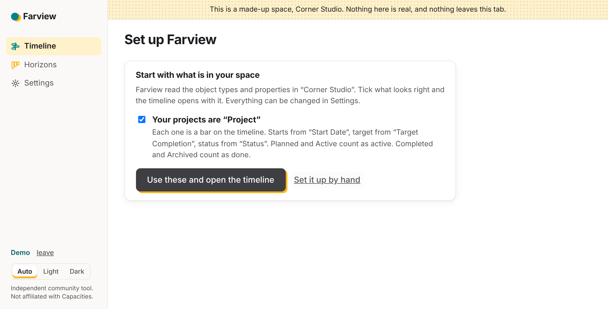

# Farview

[](https://github.com/saj-sudo/farview/actions/workflows/ci.yml)

**See your goals across time, in Capacities.**


> **Disclaimer:** Farview is an independent community tool. It is not affiliated with, endorsed by, or sponsored by Capacities. Capacities is a trademark of its respective owners.

Capacities has no timeline or Gantt view, so seeing a year of plans means moving everything into a project manager. Farview shows it where it already is. Connect a space and your projects and goals appear on a timeline:

- A line for today.
- A bar for each project, running to its target date.
- A zoom from this quarter out to the next ten years.

## Read-only by default, editing if you ask for it

- A plain connection asks for `api:read`, plus `offline_access` so you stay signed in. Farview cannot create, change or delete anything, and the consent screen shows exactly that.
- **Connect with editing** (or the toggle in Settings, which reconnects) also asks for `api:write`. Then you can add goals and projects, drag bars to move or resize their dates, and type exact dates on any card.

Two rules always hold:

- **Every write comes from something you did**, like a drag you finished or a Save you clicked. Nothing syncs in the background and nothing runs on a timer.
- **Nothing is ever deleted.** Farview creates objects and changes date properties. Removing things stays in Capacities.

You can switch back to read-only in Settings. To revoke Farview's access, go to **Settings → Capacities API → Connections** in Capacities.

## No server and no tracking

The site is static files. OAuth runs in your browser, the token stays in your browser, and every API call goes from your browser to `api.capacities.io`. There is no server, database, account or analytics.

A token kept in a browser can be read by any script on the page. For that reason Farview bundles everything, loads no third-party scripts, and sends a strict Content-Security-Policy that [a test](tests/build/csp.test.ts) checks. The token is also read-only unless you turned on editing.

## Works with your object types

Farview does not assume your space has a "Project" type. Setup reads the types and properties your space has, whatever you named them, and offers what it recognises with a tick, such as "Your projects are Project".

- Names it knows start ticked. A guess from the shape of a type says so and starts unticked.
- Nothing changes without a tick, and anything you have already mapped is left alone.
- If it can't tell, or you'd rather choose, it asks three questions:

1. Which type holds your work?
2. Which property is the start date?
3. Which property is the target date?

A preview shows your own timeline before you save. Everything else is optional:

- **A Goal type**, which most spaces lack, plus milestones and grouping by tag or property.
- **Horizons from the dates**: Now, Quarter, Year and Long. If your goals already have a horizon property, Farview can use its labels instead.
- **A Someday tray** for items without dates, so nothing drops off the page.
- **Bars that show time passed**, from start to target. Farview shows no percent complete, because a percentage on a personal goal is a guess.
- **No red.** Work past its target date gets a small marker and a plain note.


## Pillars and areas: lanes two levels deep

Many spaces sort tags in two levels: broad **pillars** (Health, Work, Money) with **areas** inside them (Home, Learning, Admin). Farview can read both. Point each level at a tag *collection* and adding a tag there adds a lane here, or pick tags by hand and click them into the order you want.

- Every (pillar, area) pair gets its own lane, so an area name used under two pillars stays two lanes.
- The pillar's name shows once, at the top of its group. Its areas sit indented under it and share its colour.
- Items tagged with a pillar but no area get a lane at the bottom of that pillar. Untagged items go last.
- One level is fine too: set the second level to "Nothing (one level)".

## Goals, projects and actions

If your space links things together, like a project pointing at its goal or a goal listing its actions, Farview can map those links too. Every one is optional and mapped by property name.

- **Click into any goal or project** for its own page: a small timeline of the item with its projects and actions, a breadcrumb up to its goal, and lists of everything under it.
- **Actions** are the smallest level, about a sitting to a day of work. Map them to Capacities' built-in Tasks or any custom type. Your day-to-day to-dos can stay where they are.
- **Milestones** are drawn as ticks on a bar, on projects and goals alike. They are separate from actions.
- **Progress is stated as counts**, like "1 of 3 actions done · 2 of 4 projects completed".
- **A goal or project with no dates of its own** takes its span from its dated children. It shows as a dashed outline, labelled as derived, and goes away once you give it real dates.
- With editing on, **+ Project and + Action on a detail page** create children that are already linked to that item.


## Seeing the load, and saving the view

- **How much runs at once.** A strip under the chart counts the projects active in each month. It states a number and nothing else, so there is no colour for "too many".
- **Save as SVG** saves the timeline as it looks on screen, with its lane names, for a weekly or yearly review. The file is built in your browser and nothing is uploaded.

## On a phone

- Under 720px wide, the timeline page opens as a list. A **List / Timeline** switch above it shows the full timeline, which you drag sideways, with bars sized for a finger.
- Dragging never moves a date on a phone. Type dates on the card instead.
- Add the site to your home screen and it opens in its own window.

A switch in the sidebar (at the bottom of the page on a phone) sets light, dark or automatic.

## What you need in Capacities

Farview needs one object type whose objects have a date, such as a Project type with a start date and a target date.

- **No such type yet?** In Capacities, open **Settings → Object Types**, choose **+ New Type**, and pick a prebuilt type such as Project from the gallery, or create your own.
- **A type with no date?** Open the type's settings, choose **Add property**, and add a date property.
- **Goals, milestones and tags are optional.** Most spaces have no Goal type, and you don't need one.

## Getting started

1. Open the site and click **Connect to Capacities**. You approve read access and pick which space to share, on the Capacities side.
2. Tick what Farview found in your space, such as "Your projects are Project". If it can't tell, or you pick **Set it up by hand**, choose your project type and its date properties. The preview shows your own timeline as you go.
3. Open the timeline. The timeline and Horizons views use the same data, on desktop and on phone. Goals, milestones and up to two levels of grouping are optional, and live under **More options** in Settings.



You don't need an account to look around: **Try the demo** runs on a made-up space, entirely in your tab.

### Use it now with a personal token

Until the hosted OAuth client is live (registration with Capacities is by email), you can run Farview against your own space with a personal API token.

1. In the Capacities desktop app, go to **Settings → Capacities API → API Tokens** and create a token for the space you want to use. Read access is enough for viewing. Give it write access and tick the editing box to plan from the timeline.
2. Paste it in the *Advanced* section on the Connect screen.
3. The token stays in your browser. You can revoke it in the same settings screen.

## Built on the official API

Farview uses the official Capacities API and the `@capacities/api` SDK. It does not use the app's internal endpoints, which can change without notice.

Dates live in object properties and list endpoints return summaries only, so Farview fetches each object on its own and draws as results arrive: the axis and today line appear first, and bars fill in after. Results are cached in your browser for 60 minutes by default, with a "last refreshed" time and a Refresh link. Large spaces are capped per run, with a "load more".

## Deploying your own

```
npm install
VITE_CAPACITIES_CLIENT_ID=your-client-id npm run build
```

The output in `dist/` is a static site, so any static host works with no server functions. `/`, `/app/` and `/callback/` are real directories, so no rewrite rules are needed.

- The client id is public by design (a PKCE public client has no client secret). Register your own redirect URI with Capacities by email; see [developers.capacities.io](https://developers.capacities.io).
- On Cloudflare Workers, the `wrangler.jsonc` in the repo serves `dist/` as static assets. It sets `preview_urls` explicitly, because Cloudflare turns preview URLs off when `workers_dev` is off.
- Link previews use absolute URLs. Change `og:image` and `og:url` in `index.html` to your own domain.

## Development

```
npm install
npm run dev     # local dev server
npm test        # vitest, node environment, no browser needed
npm run build   # typecheck + production build
npm run smoke   # after a build: every page and demo view in Chromium
```

The test suite runs the whole engine and fetch pipeline against made-up fixture spaces. See [CONTRIBUTING.md](CONTRIBUTING.md) for the rules that count as build failures, including the writing rules.

Farview looks forward. Its sibling, [Yesteryear](https://github.com/saj-sudo/yesteryear), looks back and brings your older notes back on a schedule. The two share an architecture and keep separate codebases.

## License

[MIT](LICENSE).
