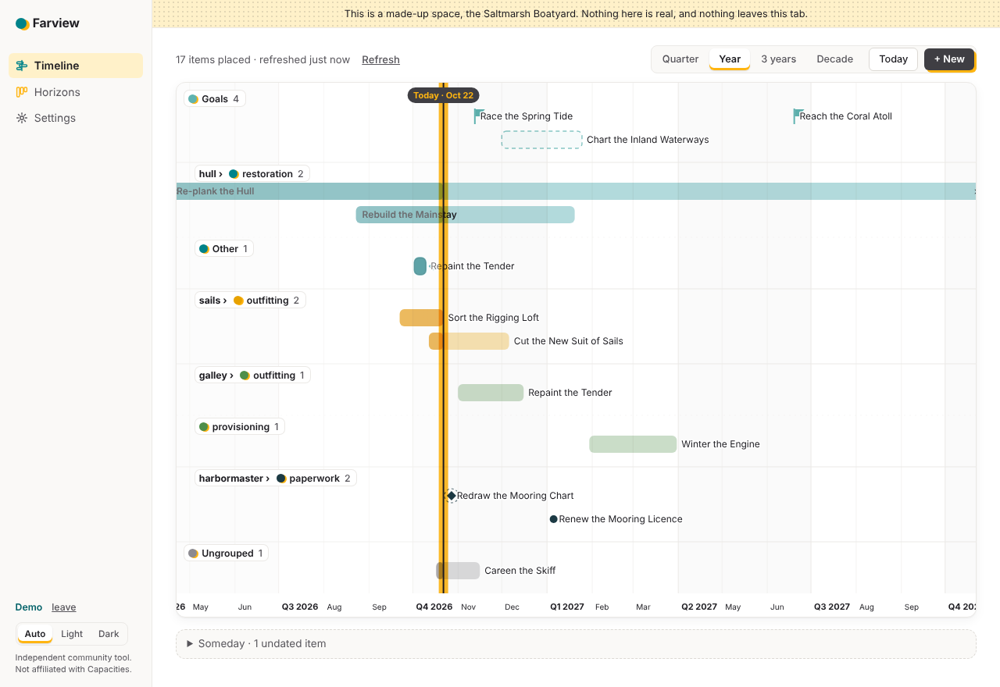
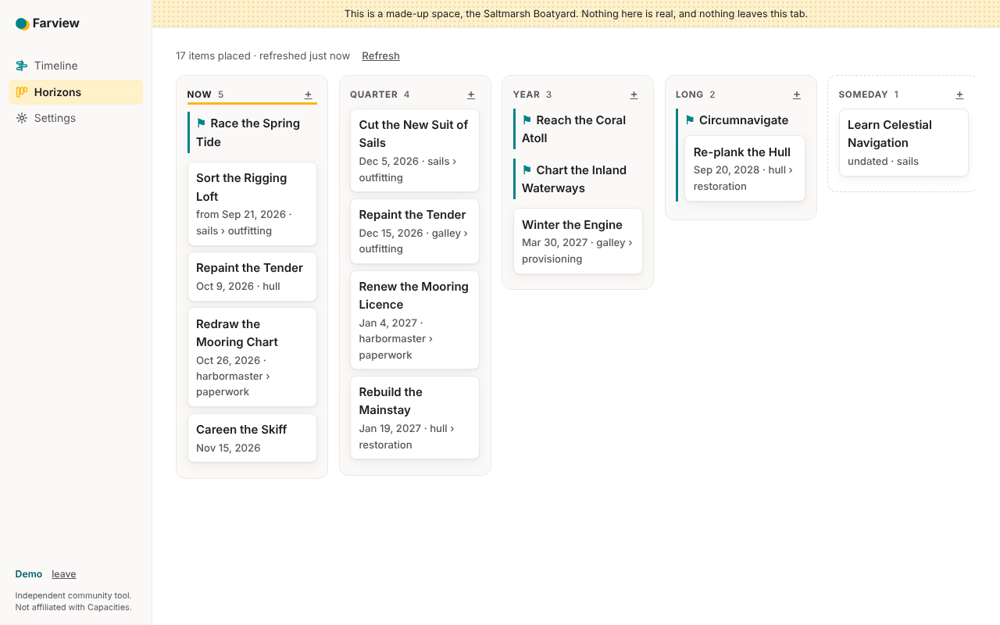
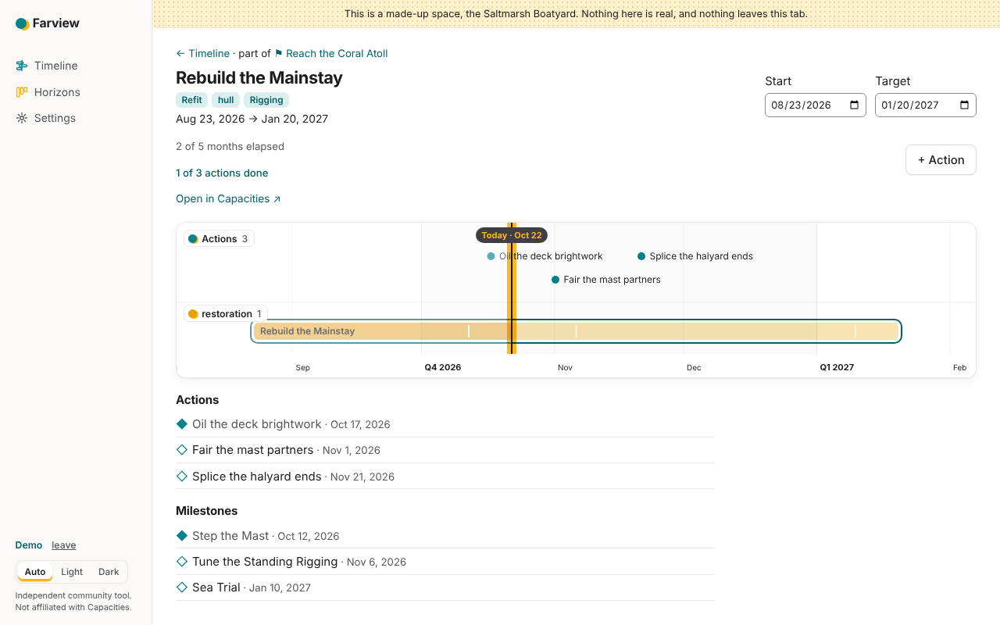

# Farview

[](https://github.com/saj-sudo/farview/actions/workflows/ci.yml)

**See your goals across time, in Capacities.**



> **Disclaimer:** Farview is an independent community tool. It is not affiliated with, endorsed by, or sponsored by Capacities. Capacities is a trademark of its respective owners.

You write your plans down in Capacities, but Capacities has no timeline or Gantt view. If you want to see what your year looks like, you have to move everything into a project manager. Farview shows it where it already is. Connect a space and your projects and goals appear on a timeline: a line for today, a bar for each project running toward its target date, and a zoom that goes from this quarter out to the next ten years.

## Read-only by default, editing if you ask for it

A plain connection asks for **`api:read` and nothing else**. Farview can't create, change or delete anything in your space, and the OAuth consent screen shows exactly that.

If you want to plan from the timeline, **Connect with editing** (or the toggle in Settings, which reconnects) also asks for `api:write`, and the consent screen says so. With editing on, you can add goals and projects from the timeline, drag bars to move or resize their dates, and type exact dates on any card. Two rules always hold:

- **Every write comes from something you did**, like a drag you finished or a Save you clicked. Nothing syncs in the background and nothing runs on a timer.
- **Nothing is ever deleted.** Farview creates objects and changes date properties. Removing things stays in Capacities.

You can switch back to read-only in Settings, and revoke Farview's access in Capacities under **Settings → Capacities API → Connections**.

## No server and no tracking

The site is a set of static files. OAuth runs in your browser, the token stays in your browser, and every API call goes from your browser to `api.capacities.io`. There is no server, database, account or analytics, so nothing of yours passes through anything the maintainer runs.

The tradeoff is that a token kept in the browser can be read by any script running on the page. That's why Farview bundles everything, loads no third-party scripts, and sends a strict Content-Security-Policy, which a test checks. The token is also read-only unless you turned on editing.

## Works with your object types

Farview doesn't assume your space has a "Project" type. Setup reads the types and properties your space actually has, whatever you named them, and asks three questions: which type holds your work, which property is the start date, and which is the target date. A Goal type is optional (most spaces don't have one), and so are milestones and grouping by tag or property. A preview shows your own timeline before you save.

- **Horizons come from the dates**: Now, Quarter, Year and Long. A space with no extra setup still gets a useful view. If your goals already have a horizon property, Farview can use its labels instead.
- **Items without dates stay visible** in a Someday tray.
- **Bars show how much time has passed**, from start to target. Farview doesn't show a percent complete, because a percentage on a personal goal is a guess.
- **Nothing turns red.** Work past its target date gets a small marker and a plain note.



## Pillars and areas: lanes two levels deep

Many spaces sort tags in two levels: broad **pillars** (Health, Work, Money) with **areas** inside them (Home, Learning, Admin). Farview can read both. Point each level at a tag *collection* and Farview follows it, so adding a tag there adds a lane here. You can also pick tags by hand and click them into the order you want.

- Every (pillar, area) pair gets its own lane, so an area name used under two pillars stays two lanes.
- The pillar's name shows once, at the top of its group. Its areas sit indented under it and share its colour, so each pillar reads as one block.
- Items tagged with a pillar but no area get a lane at the bottom of that pillar. Untagged items go last.
- One level is fine too: set the second level to "Nothing (one level)".

## Goals, projects and actions

If your space links things together, like a project pointing at its goal or a goal listing its actions, Farview can map those links too. Every one is optional and mapped by property name.

- **Click into any goal or project** for its own page: a small timeline of the item with its projects and actions, a breadcrumb up to its goal, and lists of everything under it.
- **Actions** are the smallest level, about a sitting to a day of work. Map them to Capacities' built-in Tasks or any custom type. Your day-to-day to-dos can stay where they are.
- **Milestones** are drawn as ticks on a bar, on projects and goals alike. They are separate from actions.
- **Progress is stated as counts**, like "1 of 3 actions done · 2 of 4 projects completed".
- **A goal or project with no dates of its own** takes its span from its dated children. It shows as a dashed outline, always labelled as derived, and goes away once you give it real dates.
- With editing on, **+ Project and + Action on a detail page** create children that are already linked to that item.



## Getting started

1. Open the site and click **Connect to Capacities**. You approve read access and pick which space to share, all on the Capacities side.
2. Map your space: your project type, its date properties, and optionally goals, milestones and up to two levels of grouping. The preview shows your own timeline as you go.
3. Save. The timeline and Horizons views use the same data, on desktop and on phone.

You don't need an account to look around: **Try the demo** runs on a made-up space, entirely in your tab.

### Use it now with a personal token

Until the hosted OAuth client is live (registration with Capacities is by email), you can run Farview against your own space with a personal API token. In Capacities, go to **Settings → Capacities API** and create a token. Read access is enough for viewing; give it write access and tick the editing box if you want to plan from the timeline. Then paste it in the *Advanced* section on the Connect screen. The token stays in your browser, and you can revoke it in the same settings screen.

## Built on the official API

Farview uses the official Capacities API and the `@capacities/api` SDK. It doesn't use the app's internal endpoints, which can change without notice. Dates live in object properties and list endpoints return summaries only, so Farview fetches each object on its own and draws as results arrive: the axis and today line appear first and bars fill in after. Everything is cached in your browser (60 minutes by default), with a "last refreshed" time and a Refresh link. Large spaces are capped per run, with a "load more".

## Deploying your own

```
npm install
VITE_CAPACITIES_CLIENT_ID=your-client-id npm run build
```

The output in `dist/` is a static site, so any static host works with no server functions. `/`, `/app/` and `/callback/` are real directories, so no rewrite rules are needed. On Cloudflare Workers, the `wrangler.jsonc` in the repo serves `dist/` as static assets. The client id is public by design (a PKCE public client has no client secret). Register your own redirect URI with Capacities by email; see [developers.capacities.io](https://developers.capacities.io).

## Development

```
npm install
npm run dev     # local dev server
npm test        # vitest, node environment, no browser needed
npm run build   # typecheck + production build
npm run smoke   # after a build: every page and demo view in Chromium
```

The test suite runs the whole engine and fetch pipeline against made-up fixture spaces. See [CONTRIBUTING.md](CONTRIBUTING.md) for the rules that count as build failures.

Farview looks forward. Its sibling, [Yesteryear](https://github.com/saj-sudo/yesteryear), looks back and brings your older notes back on a schedule. The two share an architecture and keep separate codebases.

## License

[MIT](LICENSE).
